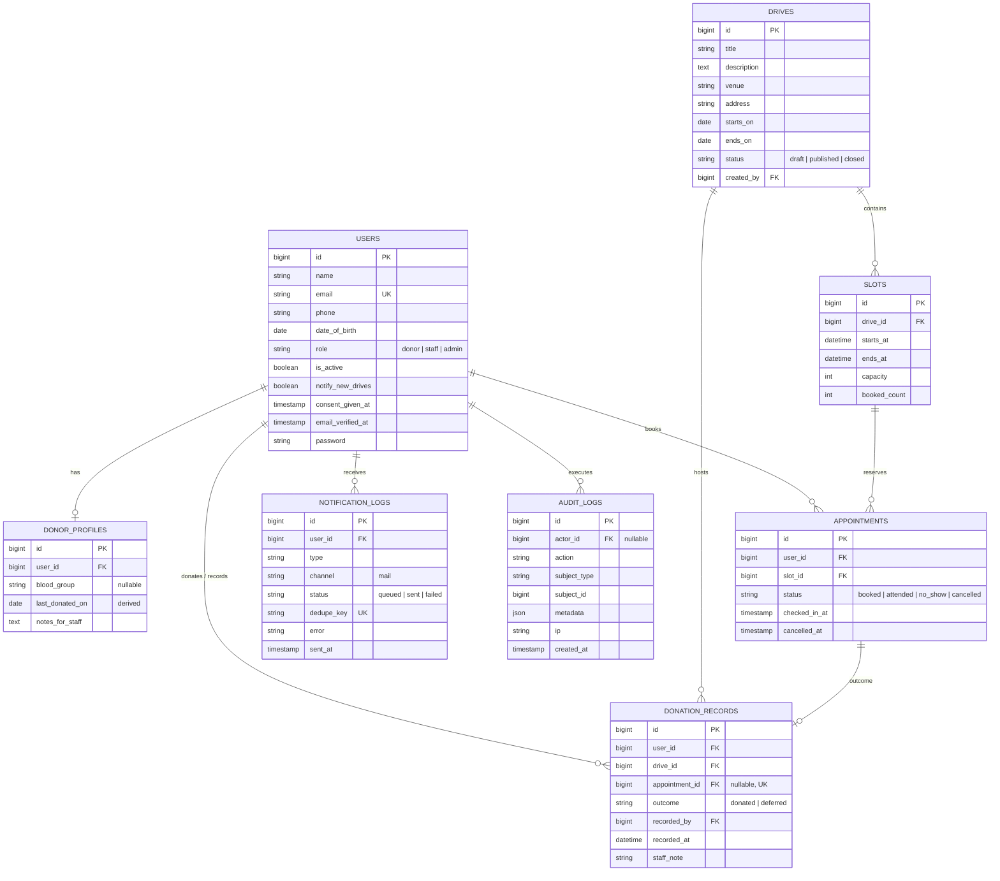

# DonorLink UG — System Architecture

DonorLink UG is an appointment booking and donor attendance platform built for the **Uganda Blood Transfusion Services (UBTS)**. It connects voluntary blood donors with scheduled blood donation drives across Kampala and regional blood collection centres.

---

## 1. Architectural Principles & Rules

1. **Atomic Slot Capacity:** Slot bookings use pessimistic row locking (`lockForUpdate()`) and direct atomic SQL increments/decrements. Capacity can never be overbooked, even under high concurrency.
2. **Derived `last_donated_on`:** Donors' last donation date is derived strictly from historical `donated` records in the system (`DonorProfile::refreshLastDonation()`). It is never directly editable by users or staff.
3. **Strictly No Medical Eligibility Logic:** DonorLink UG manages appointments and attendance only. The platform never decides, calculates, suggests, or restricts booking based on donor eligibility, donation intervals, age, or health criteria. All screening is performed on-site by certified UBTS medical professionals.
4. **Comprehensive Compliance Audit Trail:** Every privileged staff and administrative action (viewing donor records, checking in attendees, recording outcomes, exporting data, inviting staff) is recorded to the immutable `audit_logs` table with actor, action, timestamp, and IP address.
5. **Brevo Email Allowance Protection:** Email is the sole operational channel. A sliding 24-hour delivery budget protects Brevo's quota, reserving transactional bandwidth for appointments before marketing announcements.

---

## 2. Core Modules & Services

- **`BookingService` (`app/Services/BookingService.php`):** Manages appointment reservation, rescheduling, and cancellation with atomic slot capacity management and cutoff validation.
- **`AttendanceService` (`app/Services/AttendanceService.php`):** Handles on-site donor check-in, undo check-in, marking no-shows, and drive close-out.
- **`DonationRecorder` (`app/Services/DonationRecorder.php`):** Records verified donation outcomes (`donated` or `deferred`) for booked appointments and walk-in donors within the drive window or 7-day grace period.
- **`ReportService` (`app/Services/ReportService.php`):** Single source of truth for all operational metrics (booked turnout, attended, units collected, deferrals, no-shows, fill rates).
- **`CsvExportService` (`app/Services/CsvExportService.php`):** Generates streaming UTF-8 RFC 4180 CSV exports with formula injection protection (`'`, `=`, `+`, `-`, `@`).
- **`MailBudget` (`app/Services/MailBudget.php`):** Tracks rolling 24-hour email volume and ensures announcement batches never exhaust transactional reserves.
- **`AuditLogger` (`app/Services/AuditLogger.php`):** Centralized helper recording immutable compliance actions into `audit_logs`.
- **`SystemStatusService` (`app/Services/SystemStatusService.php`):** Telemetry service tracking background worker heartbeats, failed jobs, and mail volumes.

---

## 3. Events & Listeners

- **`AppointmentBooked`** &rarr; `SendAppointmentConfirmedNotification`: Dispatches confirmation email with `.ics` calendar invitation (`METHOD:PUBLISH`).
- **`AppointmentRescheduled`** &rarr; `SendAppointmentRescheduledNotification`: Dispatches updated time details and updated `.ics` calendar attachment.
- **`AppointmentCancelled`** &rarr; `SendAppointmentCancelledNotification`: Dispatches cancellation notice with reminder to remove appointment from personal calendars.

---

## 4. Scheduled Commands & Queue Jobs

| Command / Job | Frequency | Purpose |
| :--- | :--- | :--- |
| `donorlink:heartbeat` | Every minute | Writes scheduler liveness timestamp to cache (`donorlink:heartbeat:scheduler`). |
| `RecordQueueHeartbeatJob` | Every 5 minutes | Queued job writing queue worker liveness timestamp (`donorlink:heartbeat:queue_worker`). |
| `donorlink:send-reminders` | Every 10 minutes | Sweeps booked appointments starting within 24h and 2h windows and dispatches de-duplicated reminders. |
| `donorlink:dispatch-announcements` | Every 10 minutes | Dispatches queued drive announcements in rate-controlled batches respecting the Brevo mail budget. |
| `queue:prune-failed --hours=168` | Daily | Prunes failed queue jobs older than 7 days. (`audit_logs` and `notification_logs` are never pruned). |

---

## 5. Data Model (Entity-Relationship Diagram)

