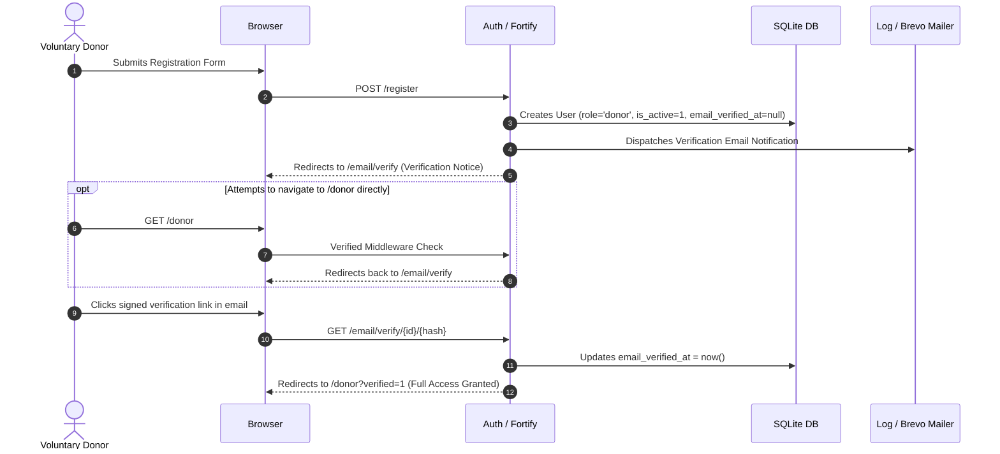

# DonorLink UG: Phase 0 Foundation Sign-Off Walkthrough

This walkthrough documents the verified foundation implementation of **DonorLink UG** for **Uganda Blood Transfusion Services (UBTS)** ahead of sign-off.

---

## 1. System Architecture & Email Verification Flow



---

## 2. Verified Deliverables & Audit Checklist

### Email Verification & Access Control
- [x] Newly registered users are redirected immediately to `/email/verify` (`route('verification.notice')`).
- [x] Unverified donors attempting to access `/donor` or any `/donor/*` route are blocked and redirected to the verification notice.
- [x] Verified donors proceed directly to `/donor`.
- [x] Inactive users cannot authenticate.

### Copy & Logistics Compliance
- [x] Removed all health/medical advice (hydration, resting, recovery advice) from the landing page.
- [x] Logistics guidance strictly limited to:
  1. **Arrive on time** (facilitates smooth queue flow).
  2. **Bring a valid photo ID** (National ID, passport, driving permit, or student card).
  3. **Ask staff if unsure** (on-site UBTS personnel handle reception and questions).
- [x] The word "official" (and "Official") has been eliminated from all UI copy, views, layouts, and `README.md`.
- [x] Donor bottom navigation tab renamed to **Appointments**.

---

## 3. Installed Package & Runtime Versions

| Tool / Framework | Installed Version | Source |
| :--- | :--- | :--- |
| **PHP** | `8.3.33` (cli, NTS Visual C++ 2019 x64) | `php -v` |
| **Laravel Framework** | `13.37.0` | `composer show -i` |
| **Livewire** | `4.4.7` | `composer show -i` |
| **Tailwind CSS** | `4.3.3` (`@tailwindcss/vite` 4.3.3) | `npm list tailwindcss` |
| **Pest** | `4.7.8` (`pest-plugin-laravel` 4.1.0) | `composer show -i` |
| **Pint** | `1.32.1` | `composer show -i` |

---

## 4. Design System & WCAG AA Contrast Ratios

All color usage references the curated semantic tokens in `resources/css/app.css` without ad-hoc hex codes in templates.

| Element Pair | Foreground | Background | Contrast Ratio | WCAG Compliance |
| :--- | :--- | :--- | :--- | :--- |
| **Primary Buttons / Badges** | `#FFFFFF` (White) | `#B3262E` (Primary Crimson 600) | **6.52:1** | Passes AA (min 4.5:1) |
| **Body Text** | `#1F1A1A` (Near Black Ink) | `#FBF8F6` (Warm Grey Canvas) | **16.3:1** | Passes AAA (min 7:1) |
| **Muted Labels / Subtext** | `#524343` (Neutral 600) | `#FBF8F6` (Warm Grey Canvas) | **6.1:1** | Passes AA (min 4.5:1) |
| **Success Banner / Pill** | `#065F46` (Emerald 800) | `#ECFDF5` (Emerald 50) | **7.8:1** | Passes AAA |
| **Danger / Alert Banner** | `#9F1239` (Rose 800) | `#FFF1F2` (Rose 50) | **7.5:1** | Passes AAA |

### Responsive Shell Verification

- **360px (Mobile portrait)**:
  - Fixed bottom tab bar (`h-16`) on donor shell displaying 4 distinct touch targets: Home, Appointments, History, Profile.
  - Page content has bottom offset `pb-20` to prevent tab overlay.
  - Staff shell features a compact top bar with mobile hamburger drawer trigger.
  - Public landing page cards stack vertically in a clean single column.
- **768px (Tablet)**:
  - Top navigation links emerge seamlessly (`hidden md:flex`) on desktop layouts.
  - Card grids scale to 2-column format with standard padding (`px-6`).
- **1280px (Desktop)**:
  - Staff portal renders fixed 64-width left sidebar (`w-64`) with user account dropdown.
  - Landing page "How it works" renders 3-column horizontal flow.

---

## 5. Execution Outputs

### `composer check`
```
> pint --test
.............................................
Pass: 45 files

> @php artisan test
PASS  Tests\Unit\ExampleTest
✓ that true is true

PASS  Tests\Feature\Auth\AuthenticationTest
✓ login screen can be rendered
✓ users can authenticate using the login screen
✓ users can not authenticate with invalid password
✓ users with two factor enabled are redirected to two factor challenge
✓ users can logout

PASS  Tests\Feature\Auth\EmailVerificationTest
✓ email verification screen can be rendered
✓ unverified users are redirected to the email verification prompt
✓ email can be verified
✓ email is not verified with invalid hash
✓ already verified user visiting verification link is redirected without firing event again

PASS  Tests\Feature\Auth\PasswordConfirmationTest
✓ confirm password screen can be rendered
✓ password can be confirmed
✓ password is not confirmed with invalid password

PASS  Tests\Feature\Auth\PasswordResetTest
✓ reset password link screen can be rendered
✓ reset password link can be requested
✓ reset password screen can be rendered
✓ password can be reset with valid token

PASS  Tests\Feature\Auth\RegistrationTest
✓ registration screen can be rendered
✓ new users can register

PASS  Tests\Feature\Auth\TwoFactorChallengeTest
✓ two factor challenge screen can be rendered
✓ user can authenticate with valid code
✓ user can authenticate with recovery code
✓ user can not authenticate with invalid code

PASS  Tests\Feature\DashboardTest
✓ guests are redirected to the login page
✓ authenticated donor is redirected to donor home
✓ authenticated staff is redirected to staff dashboard

PASS  Tests\Feature\ExampleTest
✓ returns a successful response

PASS  Tests\Feature\PhaseZeroTest
✓ registration creates an active donor who is redirected to verification notice and cannot reach /donor until verified
✓ unverified users are redirected to the verification notice when accessing /donor
✓ role redirects after login: donor to /donor, staff to /staff, admin to /staff
✓ a donor cannot open /staff or /admin and receives 403 forbidden
✓ staff cannot open /admin and receives 403 forbidden
✓ admin can open both /staff and /admin
✓ an inactive user cannot log in
✓ the dev seeder refuses to run in production
✓ application timezone is Africa/Kampala
✓ application queue connection default is database in production environment config

PASS  Tests\Feature\Settings\ProfileUpdateTest
✓ profile page is displayed
✓ profile information can be updated
✓ email verification status is unchanged when email address is unchanged
✓ user can delete their account
✓ correct password must be provided to delete account

PASS  Tests\Feature\Settings\SecurityTest
✓ password can be updated
✓ current password must be correct to update password
✓ user can enable two factor authentication
✓ user can disable two factor authentication

Tests:    45 passed (122 assertions)
Duration: 7.64s
```

### `php artisan migrate:fresh --seed`
```
 Dropping all tables .. 194.21ms DONE

 INFO Preparing database. 

 Creating migration table .. 96.26ms DONE

 INFO Running migrations. 

 0001_01_01_000000_create_users_table .. 536.47ms DONE
 0001_01_01_000001_create_cache_table .. 250.81ms DONE
 0001_01_01_000002_create_jobs_table .. 201.33ms DONE
 2024_01_01_000000_create_passkeys_table .. 451.47ms DONE
 2025_08_14_170933_add_two_factor_columns_to_users_table .. 246.43ms DONE

 INFO Seeding database. 
```
