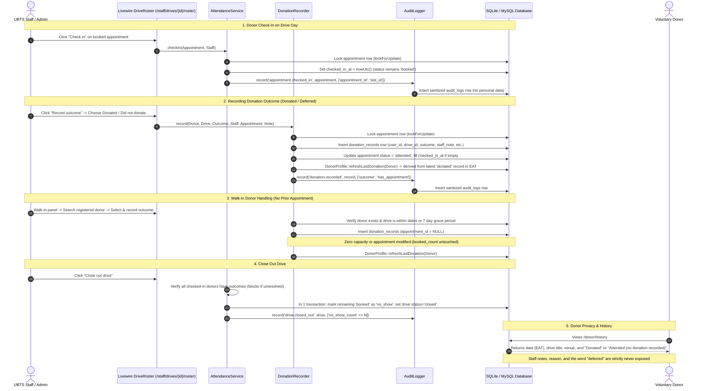

# DonorLink UG: Phase 5 (Attendance, Outcomes, Donor Records and Audit Log) Walkthrough

This walkthrough documents the implementation, database schema, services architecture, staff screens, donor interfaces, audit privacy guarantees, and verification procedures for **Phase 5: Attendance, Outcomes, Donor Records and Audit Log** for **Uganda Blood Transfusion Services (UBTS)**.

---

## 1. System Architecture & Domain Workflows

---

## 2. Key Phase 5 Deliverables

### A. Additive Database Migrations
1. **`donation_records` Table** (`database/migrations/2026_10_18_000008_create_donation_records_table.php`):
   - `user_id`: Foreign key to `users` (cascade on delete).
   - `drive_id`: Foreign key to `drives` (cascade on delete).
   - `appointment_id`: Nullable foreign key to `appointments` (null on delete), unique where present. Walk-ins have `NULL`.
   - `outcome`: String matching `DonationOutcome` enum (`donated`, `deferred`).
   - `recorded_by`: Foreign key to `users` (the staff member who entered the record).
   - `recorded_at`: Timestamp in UTC.
   - `staff_note`: Nullable string capped at 255 characters.
   - **Unique Compound Constraint**: `UNIQUE(user_id, drive_id)` enforcing at most one record per donor per drive.
   - Compound and single indexes: `user_id`, `drive_id`, `recorded_at`.

2. **`audit_logs` Table** (`database/migrations/2026_10_18_000009_create_audit_logs_table.php`):
   - `actor_id`: Nullable foreign key to `users` (null on delete).
   - `action`: String identifying sensitive action (e.g. `donor.viewed`, `donor.updated`, `appointment.checked_in`, `donation.recorded`, `donation.corrected`, `drive.closed_out`).
   - `subject_type` & `subject_id`: Nullable polymorphic identifier for audited model.
   - `metadata`: JSON payload containing only IDs, counts, and changed field name arrays.
   - `ip`: Client IP address.
   - `created_at`: Timestamp in UTC (`$timestamps = false`).
   - Compound indexes: `['actor_id', 'created_at']` and `['subject_type', 'subject_id']`.

---

### B. Domain Services Layer
1. **`App\Services\AttendanceService`**:
   - `checkIn(Appointment $appointment, User $actor)`: Idempotent check-in for `booked` appointments on published/closed drives when slot date is today (EAT) or drive is running. Locks appointment row with `lockForUpdate()`.
   - `undoCheckIn(Appointment $appointment, User $actor)`: Reverts `checked_in_at` to `null` if no outcome has been recorded.
   - `markNoShow(Appointment $appointment, User $actor)`: Marks a `booked` appointment with no outcome as `no_show`. Preserves slot capacity (does not decrement `booked_count`).
   - `cancelByStaff(Appointment $appointment, User $actor)`: Staff cancellation. Conditionally decrements slot `booked_count`, marks appointment `cancelled`, dispatches `AppointmentCancelled` event to email donor, and writes `appointment.cancelled_by_staff` audit log.
   - `closeOutDrive(Drive $drive, User $actor)`: Blocks if any checked-in appointment lacks an outcome. Otherwise, in a single transaction, marks all remaining `booked` appointments as `no_show`, sets drive status to `closed`, and writes a single `drive.closed_out` audit entry with the count.

2. **`App\Services\DonationRecorder`**:
   - `record(User $donor, Drive $drive, DonationOutcome $outcome, User $staff, ?Appointment $appointment, ?string $note)`:
     - For appointments: validates donor ownership, drive match, `booked` status, and ensures no duplicate record exists.
     - For walk-ins: validates donor is active and drive is published/closed within drive dates or `config('donorlink.recording_grace_days')` (default: 7 days) after `ends_on`.
     - Creates `DonationRecord`, sets appointment to `attended` (for both `donated` and `deferred`), fills `checked_in_at` if missing, recalculates `DonorProfile::refreshLastDonation()`, and writes audit log.
   - `correct(DonationRecord $record, DonationOutcome $newOutcome, User $staff, ?string $note)`:
     - Allows staff to correct outcome and note. Recalculates `DonorProfile::refreshLastDonation()` and writes `donation.corrected` audit log.
     - Strictly no deletion of donation records.

3. **`App\Services\AuditLogger`**:
   - Captures client IP.
   - Strict Privacy Sanitizer: drops all personal details, medical text, notes, contact information, and blood group values, logging only IDs, status strings, and changed field names (e.g. `['blood_group', 'notes_for_staff']`).

---

### C. Staff Screens & Polling Roster
1. **Drive Roster (`/staff/drives/{drive}/roster`)**:
   - Summary statistics bar: Expected (booked), Checked In, Donated, Did Not Donate, No-Show, Cancelled, Walk-Ins.
   - Appointments grouped by time slot with donor name, phone, unverified email hints, and status badges.
   - Real-time search by donor name or phone; filter chips by status.
   - Large touch targets (min 44px) for mobile/tablet usability on site.
   - Outcome modal with plain-language choices: **Donated** and **Did not donate**, optional administrative note input (labelled "Administrative note (do not enter medical details)"), and confirmation step.
   - Walk-in donor registration panel with instant search across registered active donors. If not found: *"No account found. Ask the donor to register at this site, then search again."*
   - Auto-refreshes every 30 seconds via `wire:poll.30s` preserving open modal state and input.
   - Query efficiency: Flat query count (8 queries) even with 40+ appointments.

2. **Close Out Drive Workflow**:
   - Available on roster and drive detail pages when drive slots have ended or `ends_on` has passed (EAT).
   - Pre-validation lists any unresolved checked-in donors requiring outcomes before close-out.
   - Confirmation modal details the exact number of remaining bookings to be converted to no-show.

3. **Donor Management (`/staff/donors` and `/staff/donors/{user}`)**:
   - Searchable, paginated directory by name, phone, or email.
   - Detailed view displaying profile details, appointment history, and donation records.
   - Staff can edit **blood group** (restricted to standard ABO/Rh values: `A+`, `A-`, `B+`, `B-`, `AB+`, `AB-`, `O+`, `O-`, or empty) and **notes for staff** (capped at 500 characters).
   - `last_donated_on` is derived and read-only.
   - Audited: viewing writes `donor.viewed`; updating writes `donor.updated` with changed field names only.
   - Record correction modal with audit trail.

4. **Audit Log Viewer (`/admin/audit-log`)**:
   - Restricted to system Administrators.
   - Paginated table showing time (EAT), actor, action, subject, and human-readable metadata summary.
   - Filtering by action, actor, and date range.

---

### D. Donor Interface & Privacy
1. **Donation History (`/donor/history`)**:
   - Chronological list (newest first): Date (EAT), drive title, and venue.
   - Outcome displayed strictly as **Donated** or **Attended (no donation recorded)**.
   - The word "deferred", rejection reasons, and staff notes are completely withheld.
   - Header displays total donations and date of last donation.
   - Completely free of next-eligible dates or waiting period wording.
   - Honest empty state: *"Your donation history will appear here after you attend a drive."*

2. **Appointments Tab (`/donor/appointments`)**:
   - Slots that have ended are automatically placed in the **Past** tab.
   - Ended bookings without recorded outcomes are badged as **Not recorded**.
   - Completed outcomes display **Attended**, missed appointments display **Missed**, and staff cancellations display **Cancelled**.
   - Donor dashboard "Next appointment" card ignores past/ended slots.

---

## 3. Strict Prohibitions & Non-Functional Verification

1. **No Eligibility Logic Anywhere**:
   - Verified via codebase-wide inspection that no minimum intervals, next-eligible calculations, age gates, or health checks exist in models, services, controllers, or views.
   - System strictly records staff decisions without automated judgment.
2. **Zero Automated No-Show Jobs**:
   - No scheduled commands or automated listeners mark no-shows. Only staff actions mark no-shows during drive close-out or individual attendance review.
3. **Audit Privacy Guarantees**:
   - Audit metadata contains zero medical details, staff notes, blood groups, or contact information.
