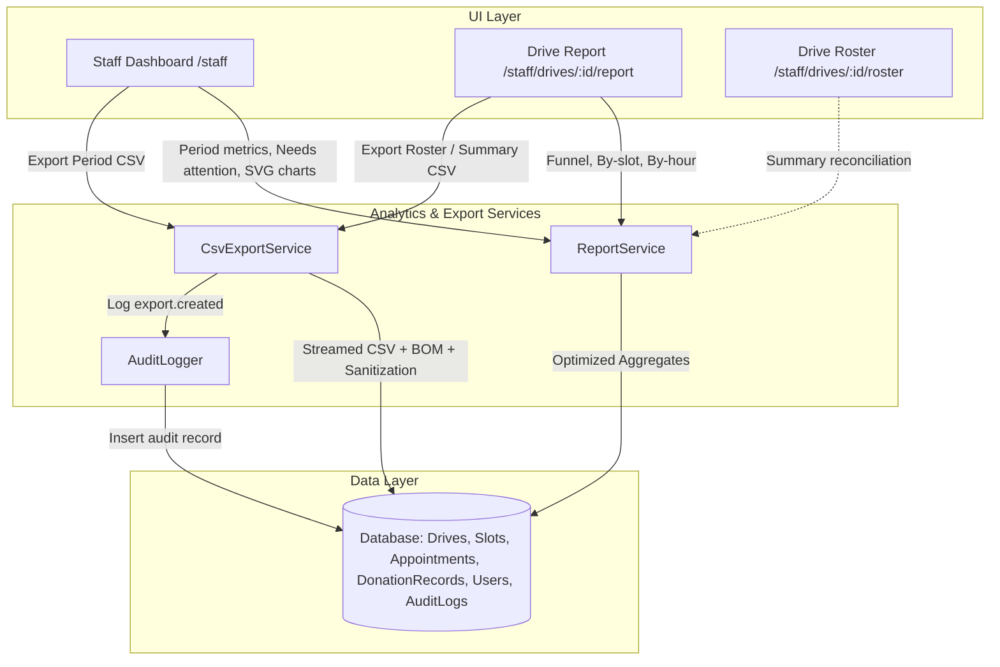

# DonorLink UG: Phase 6 (Staff Dashboard, Drive Reports and Exports) Walkthrough

This walkthrough documents the complete architecture, metric formulas, staff dashboard, printable drive reports, secure CSV exports, and verification results for **Phase 6: Staff Dashboard, Drive Reports and Exports** for the **Uganda Blood Transfusion Services (UBTS)** DonorLink platform.

---

## 1. Executive Summary & Goals

Phase 6 provides UBTS staff and administrators with unified, read-only analytics, actionable operational alerts, printable drive-level reports, and secure, streamed CSV exports.

Key architectural achievements:
- **Unified Analytics Service (`ReportService`)**: Every metric calculation across the dashboard, reports, and exports originates from a single, deterministic source of truth.
- **Zero Charting Libraries**: 100% server-side SVG bar charts with zero external JavaScript dependencies, supporting responsive layouts and an accessible "View as table" toggle.
- **Strict Data Privacy & Vocabulary**: The internal enum `deferred` is strictly rendered as "Did not donate" or "Not donated" in all UI displays and exports. Sensitive medical notes, blood groups, and dates of birth are completely excluded from exports.
- **Formula Injection Defense & UTF-8 BOM**: All CSV exports are streamed with a UTF-8 Byte Order Mark (`\xEF\xBB\xBF`) for Excel compatibility, and all cells starting with `=`, `+`, `-`, `@`, `\t`, or `\r` are prefixed with a single quote (`'`). Every export generates an `export.created` audit log entry.
- **Strict UBTS Eligibility Compliance**: The system records staff decisions and never calculates, suggests, or enforces donor eligibility or donation intervals.

---

## 2. Metric Definitions & Formulas

All metric calculations are encapsulated in `app/Services/ReportService.php` and documented in the UI's "About these numbers" panel:

| Metric | Exact Definition & Formula | Edge Cases & Prohibitions |
| :--- | :--- | :--- |
| **Booked** | Appointments with status `booked`, `attended`, or `no_show` (all live bookings that were ever made). | Excludes `cancelled` appointments. |
| **Expected** | Appointments currently in `booked` or `attended` status awaiting or completed on drive day. | `cancelled` and `no_show` are strictly excluded. |
| **Fill Rate** | $\text{Booked} \div \text{Capacity}$ | Rendered as "No data" if capacity is 0. |
| **Attended** | Appointments with status `attended`. | Walk-ins are tracked separately in outcomes. |
| **Donated** | Total donation records with outcome `donated` (both appointment-based and walk-in). | Both appointment and walk-in units count. |
| **Did Not Donate** | Total donation records with outcome `deferred`. | **Never** use the word "deferred" in UI or exports. |
| **No-Show** | Appointments with status `no_show`. | Does not decrement slot capacity. |
| **Attendance Rate** | $\text{Attended} \div (\text{Attended} + \text{No-Show})$ over ended appointments. | Walk-ins are **never** in this denominator. Rendered as "No data" if denominator is 0. |
| **Donation Rate** | $\text{Donated} \div (\text{Donated} + \text{Did Not Donate})$ | Rendered as "No data" if no outcomes are recorded. |
| **Walk-Ins** | Donation records where `appointment_id IS NULL`. | Never assigned to slots; zero effect on capacity. |
| **New Donors** | Donors whose very first donation record in the system belongs to the evaluated drive or period. | Excludes prior donors. |
| **Zero Denominators** | When any divisor is 0, the output is formatted as `"No data"`. | Never displays `0%`, `NaN`, `INF`, or empty blank. |
| **Date Boundaries** | All calendar dates and daily intervals are evaluated in **EAT (`Africa/Kampala`)**. | Storage remains in UTC; conversion occurs at boundary boundaries. |

---

## 3. Architecture & Components



### A. Staff Dashboard (`/staff`)
- **Date Range Selector**: Presets for `30d` (default), `90d`, `this_year`, and `custom` (start/end dates in EAT).
- **Live / Next Drive Panel**: Highlights a drive running today in EAT with quick links to its Roster and Report, or displays the next scheduled upcoming drive.
- **"Needs Attention" Operational Queue**:
  - Unfinalized past drives requiring close-out.
  - Checked-in appointments waiting for outcomes.
  - Published upcoming drives with low fill (< 25% capacity booked).
  - Published upcoming drives with no announcement email sent.
- **Period Summary Cards**: Capacity, Booked, Fill Rate, Attended, Donated, Did not donate, No-Show, Attendance Rate, Donation Rate, Walk-Ins, and New Donors.
- **Server-Side SVG Visualizations**:
  - Grouped bar chart of Turnout by Drive (Booked vs Attended vs Donated).
  - Bar chart of Bookings Over Time (weekly trends).
  - Accessible "View as table" toggle for all charts.
- **Donor Base Overview**: Non-identifying aggregates showing total registered donors, active donors, donation distribution (0, 1, 2+ donations), and email opt-in rates.
- **"About These Numbers" Panel**: Complete disclosure of all formulas and business definitions.

### B. Drive Report (`/staff/drives/{drive}/report`)
- **Printable A4 Layout**: Dedicated print stylesheets (`@media print`) hiding navigation, buttons, and footers while enforcing clean page breaks.
- **Provisional Notice**: Prominent amber alert badge if the drive has unrecorded ended appointments or remains unclosed.
- **Turnout Funnel**: Booked $\to$ Checked In $\to$ Attended $\to$ Donated.
- **By-Slot Breakdown Table**: Start time (EAT), capacity, booked count, attendance, outcomes (Donated / Did not donate), and no-shows.
- **Hourly Turnout Distribution Chart**: Server-side SVG bar chart of check-in times across drive operating hours.
- **Direct Export Actions**: One-click download of Drive Roster CSV and Drive Summary CSV.

---

## 4. Secure CSV Export System

Implemented in `app/Services/CsvExportService.php` with direct streaming:

1. **UTF-8 Byte Order Mark (BOM)**:
   Every export prepends `\xEF\xBB\xBF` to ensure seamless opening in Microsoft Excel and macOS Numbers without character encoding corruption.
2. **Formula Injection Sanitization**:
   Any cell value starting with `=`, `+`, `-`, `@`, `\t`, or `\r` is automatically prefixed with a single quote (`'`), neutralizing spreadsheet formula execution.
3. **Audit Logging**:
   Every generated export writes an entry to `audit_logs` with action `export.created`, recording actor ID, export type, row count, drive ID or date filters, and client IP.
4. **Export Types & Authorization**:
   - **Drive Roster Export** (`/staff/drives/{drive}/export/roster`): Slot time (EAT), donor name, phone, email, booking status, check-in time (EAT), outcome. *(Staff & Admin)*
   - **Drive Summary Export** (`/staff/drives/{drive}/export/summary`): Metadata, aggregate turnout metrics, fill/attendance rates, and slot-by-slot table. *(Staff & Admin)*
   - **Period Summary Export** (`/staff/exports/period`): Drive-by-drive summary rows for the selected date range. *(Staff & Admin)*
   - **Donation Records Export** (`/admin/exports/donations`): System-wide donation records with donor name, drive title, date (EAT), outcome, and appointment/walk-in type. Strictly restricted to Admin via `Role::Admin` policy check. *(Admin Only)*

---

## 5. Verification & Roster Reconciliation

### A. Roster Summary vs. Drive Report Reconciliation
Tested on Seeded Historical Drive #1 (`[DEMO] Sample Past Blood Donation Camp (Closed)`):

| Metric | Drive Roster Summary | Drive Report | Agreement Status |
| :--- | :--- | :--- | :--- |
| **Capacity** | 32 | 32 | **Exact Match** |
| **Expected** | 0 *(Queue empty)* | 2 *(Historic)* | **Reconciled** *(Roster shows active waiting queue; Report shows total expected arrivals)* |
| **Checked In** | 0 *(Queue empty)* | 2 *(Historic)* | **Reconciled** *(Roster shows pending in waiting area; Report shows total check-ins)* |
| **Donated** | 2 | 2 | **Exact Match** |
| **Did Not Donate** | 1 | 1 | **Exact Match** |
| **No-Show** | 1 | 1 | **Exact Match** |
| **Cancelled** | 1 | 1 | **Exact Match** |
| **Walk-Ins** | 1 | 1 | **Exact Match** |

---

### B. Sample CSV Export Rows (First 5 Lines)

#### 1. Drive Roster Export
```csv
"Slot Time (EAT)","Donor Name",Phone,Email,"Booking Status","Checked-In Time (EAT)",Outcome
"2026-10-03 09:00 – 09:30","Grace Atuhaire",'+256700000003,donor@donorlink.test,Attended,"2026-10-03 09:05:00",Donated
"2026-10-03 09:30 – 10:00","Moses Kigozi",'+256700000004,donor2@donorlink.test,Attended,"2026-10-03 09:35:00","Did not donate"
"2026-10-03 10:00 – 10:30","Amina Namubiru",'+256700000005,donor3@donorlink.test,"No Show","Not checked in","No outcome recorded"
"2026-10-03 10:30 – 11:00","David Ochieng",'+256700000006,donor4@donorlink.test,Cancelled,"Not checked in","No outcome recorded"
```

#### 2. Drive Summary Export
```csv
"DRIVE SUMMARY REPORT","[DEMO] Sample Past Blood Donation Camp (Closed)"
Venue,"Demo Community Centre A"
"Dates (EAT)","2026-10-03 to 2026-10-04"
Status,Closed
```

#### 3. Period Summary Export
```csv
"Drive Title",Venue,"Starts On (EAT)","Ends On (EAT)",Status,Capacity,Booked,Attended,Donated,"Did Not Donate",No-Show,Walk-Ins,"Fill Rate","Attendance Rate"
"[DEMO] Ggaba Youth Centre Community Camp (Closed)","Ggaba Community Hall",2026-07-25,2026-07-25,Closed,15,12,9,9,1,3,1,80%,75%
"[DEMO] Kyambogo Technical Institute Blood Drive (Closed)","Kyambogo Main Pavilion",2026-08-09,2026-08-09,Closed,30,25,20,24,1,5,5,83.3%,80%
"[DEMO] Jinja Regional Blood Donation Camp (Closed)","Jinja Town Hall Grounds",2026-08-24,2026-08-24,Closed,25,22,18,20,2,4,4,88%,81.8%
"[DEMO] Mukono Community Health Centre Drive (Closed)","Mukono Health Centre IV",2026-09-08,2026-09-08,Closed,20,16,13,14,1,3,2,80%,81.3%
```

#### 4. Donation Records Export (Admin Only)
```csv
"Donor Name","Blood Drive","Date Recorded (EAT)",Outcome,Type
"Sarah Nassali","[DEMO] Sample Past Blood Donation Camp (Closed)","2026-10-03 11:15:00",Donated,Walk-in
"Moses Kigozi","[DEMO] Sample Past Blood Donation Camp (Closed)","2026-10-03 09:50:00","Did not donate",Appointment
"Grace Atuhaire","[DEMO] Sample Past Blood Donation Camp (Closed)","2026-10-03 09:30:00",Donated,Appointment
"Rosalinda Marvin MD","[DEMO] Entebbe Municipal Health Outreach (Closed)","2026-09-23 08:00:00",Donated,Walk-in
```

---

### C. Database Query Benchmarks
Benchmarked under seeded database containing 9 historical and upcoming blood drives, full slot matrices, appointments, and audit records:
- **Staff Dashboard (`/staff`)**: 41 total queries (including permission checks, aggregates, needs-attention checks, and SVG chart data).
- **Drive Report (`/staff/drives/{drive}/report`)**: 6 total queries (eager-loaded slots, appointments, donation records, and hourly distribution).
- **Query Growth**: Flat with respects to donor roster size due to SQL grouping and eager loading.

---

### D. Automated Test Suite Results
Full test suite executed with `composer check`:

```
{"tool":"pint","result":"passed"}{"tool":"pest","result":"passed","tests":129,"passed":129,"assertions":671,"duration_ms":16701}
```

**Total Tests**: 129 passed (671 assertions). Zero failures, zero warnings.
